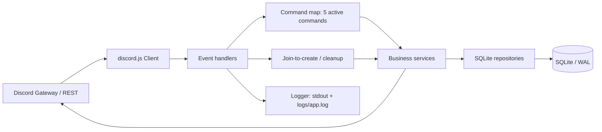
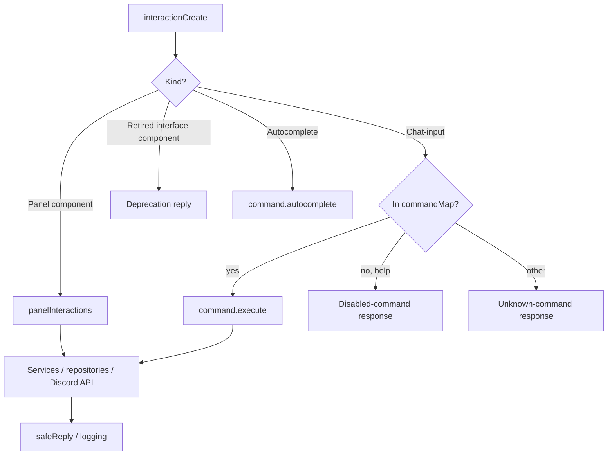
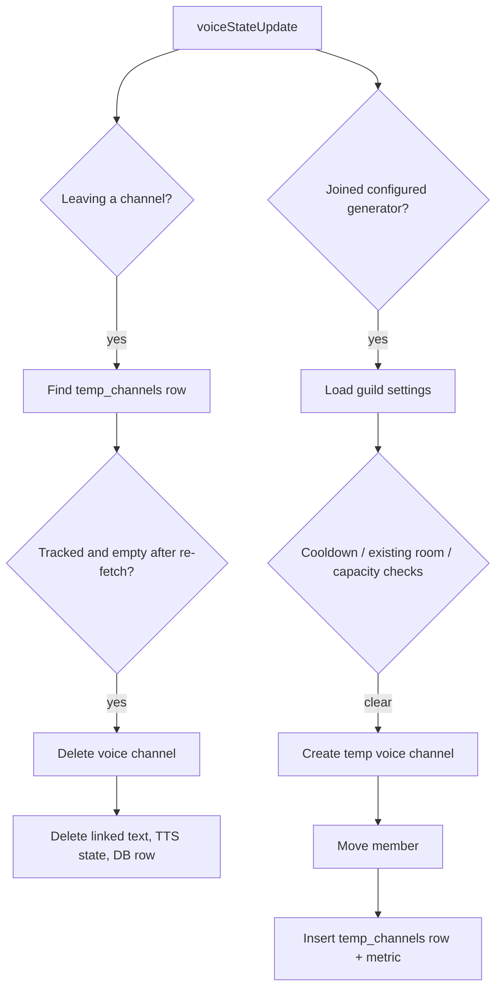
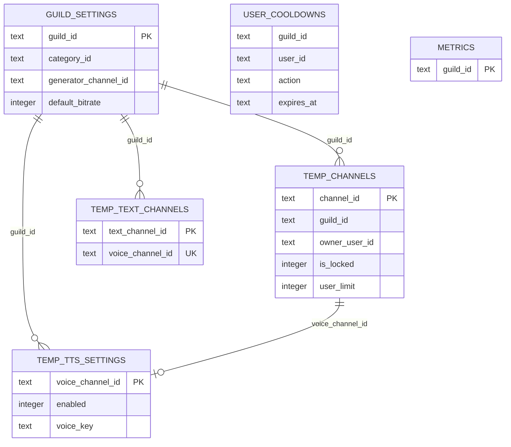

# Pemucik / Pemucik: Actual Architecture

## Scope and evidence

This is a code-grounded description of the repository as inspected on 2026-11-18. It describes the active runtime, plus dormant code that remains in the repository. Discord-facing strings are Russian-first; this document uses the current public name **Pemucik** and the package/repository name **Pemucik** where useful.

## What runs

`src/index.ts` is the sole application entry point. It loads and validates the environment, creates a `Logger` and Discord client, opens SQLite lazily, registers five event handlers, and logs in. The client requests `Guilds`, `GuildVoiceStates`, `GuildMembers`, `GuildMessages`, and `MessageContent`. It registers handlers for `clientReady`, `interactionCreate`, `channelDelete`, `voiceStateUpdate`, and `messageCreate`.

The active slash-command registry in `src/commands/index.ts` contains exactly `/setup`, `/support`, `/voice`, `/set`, and `/reset`. Commands are registered by `scripts/registerCommands.ts` against a guild when `DISCORD_GUILD_ID` exists, otherwise globally. The script can clear the opposite global scope only when `DISCORD_CLEAR_OPPOSITE_SCOPE=true`.



## Startup and shutdown

```mermaid
sequenceDiagram
  participant P as Node process
  participant B as bootstrap/index.ts
  participant D as SQLite
  participant C as Discord client
  participant G as Discord Gateway
  P->>B: start
  B->>B: getEnv(), new Logger(), createDiscordClient()
  B->>D: getDatabase() (WAL, foreign_keys=ON)
  B->>C: register ready, interaction, delete, voice, message handlers
  B->>G: client.login(token)
  G-->>C: clientReady
  C->>D: recover tracked rooms per cached guild
  P->>B: SIGINT/SIGTERM
  B->>B: destroyAllTempTtsPlayback()
  B->>D: closeDatabase()
  B->>C: destroy(); exit(0)
```

The ready handler performs best-effort recovery: stale tracked voice-room rows and their associated artifacts are removed; empty rooms are rechecked and deleted; linked text-channel permissions are synchronized for occupied tracked rooms. Errors are logged per guild rather than aborting readiness.

## Interaction architecture

`interactionCreate.ts` dispatches component interactions before commands. Panel IDs (`xv:panel:*`) reach `panelInteractions.ts`; retired persistent-interface IDs (`xv:interface:*`) receive an ephemeral deprecation reply rather than their retained handler. Autocomplete reaches an optional command method. Chat-input commands resolve via `commandMap`, execute with a logger context, and use `safeReply` for error recovery.



The grouped `/voice` command is the dominant active command surface. It resolves a DB-tracked temporary room through `panelService`, then delegates mutations to `panelService` or `voiceControlService`. Owner, admin (`Administrator` or `ManageChannels`), and abandoned-room claimant access modes are resolved centrally. Legacy standalone `/panel`, `/rename`, `/lock`, `/unlock`, `/limit`, `/claim`, `/help`, and `/interface` modules remain but are not registered.

## Join-to-create and cleanup

`voiceStateUpdate.ts` is the authoritative lifecycle handler. On a leave it syncs a linked text room (if any), then asks `cleanupService` to delete only a row-confirmed empty room. Generator joins are serialized per guild through `KeyedSerialExecutor`, then recheck settings, cooldown, prior ownership, maximum channel count, and that the member is still in the generator. The handler creates the Discord channel, moves the member, then inserts the tracking row and metrics. Failed moves delete the just-created Discord channel before rethrowing. A crash or persistence failure after the move can still leave an untracked room; compensating deletion is blocked by the protected deletion policy.



## Persistence and state

SQLite is accessed synchronously through `better-sqlite3`; `database.ts` owns one process-local connection. Repositories are thin SQL mappers, rather than an ORM. The schema has six application tables:



The crucial safety boundary is `temp_channels`: mutation target resolution starts from a DB row, and destructive cleanup/delete paths check that row before deleting a Discord voice channel. Text mappings and TTS settings are removed as artifacts of tracked voice-room deletion.

## Recovered local TTS subsystem

The local Piper TTS pipeline is active but not yet live-verified. `/voice tts` persists owner/admin-controlled room settings after preflighting Piper, the selected model, FFmpeg, and Opus support. `messageCreate.ts` accepts native voice-channel chat and stored linked-text fallback messages only when the author is connected to the exact tracked room. Intake is rate-limited; room and guild queues are bounded; playback is serialized per guild; active synthesis/playback is cancelled during disable, deletion, and shutdown; and temporary WAV files are removed on every exit path.

The Message Content privileged intent must also be enabled in the Discord Developer Portal. The current development machine lacks Piper and FFmpeg, so the recovered path remains blocked by runtime preflight until the host is prepared. See `docs/tts-investigation.md` for the failure analysis and verification boundary.

**In simple terms:** TTS is reachable and guarded in code, but it deliberately refuses activation until the local audio tools exist and Discord allows message content.

## Dormant and retained subsystems

Persistent interface modules can create a shared text channel/message and process component actions, but startup no longer restores them, commands do not expose `/interface`, and the dispatcher returns a disabled reply. These retained modules are unreachable in the current process.

## Cross-cutting behavior

- **Configuration:** `dotenv` loads once at import. `getEnv` validates required token/client ID and typed optional settings. Runtime TTS reads Piper-related environment variables directly only when invoked and preflights them before room enablement.
- **Logging:** `Logger` emits structured JSON-like payloads to stdout and synchronously appends to `logs/app.log`; errors serialize `Error` message and stack.
- **Responses:** active long-running commands and components acknowledge immediately. `safeReply` chooses reply, edit, or follow-up based on interaction state, strips immutable flags from deferred edits, and can log Discord's already-acknowledged/unknown-interaction codes 10062 and 40060.
- **Embed color:** `embedColor.ts` fetches the bot avatar PNG with a 1.5-second timeout, parses/decompresses supported PNG forms itself, selects a dominant color, caches by avatar URL, and falls back to `APP_COLOR`.
- **Verification:** `npm test` compiles the repository and runs the generated JavaScript tests with Node's built-in runner, avoiding the audited Windows `tsx` startup failure.
- **Shutdown:** handlers call synchronous DB close and `client.destroy`, but use `process.exit(0)` immediately after initiating client destruction.

## Architectural assessment

The intended thin handler / service / repository layering is real and generally clear. The main exception is breadth concentration in `voice.ts`, `voiceControlService.ts`, `panelService.ts`, and `ttsPlaybackService.ts`. Retired interface and standalone-command implementations duplicate active room-control paths. There is no observed runtime import cycle among source modules, but the retained interface/TTS surface makes the repository larger and less immediately legible than the active bot behavior.

The migration mechanism is additive but not versioned: `migrate.ts` re-executes schema SQL and conditionally alters `guild_settings`. That is adequate for its current columns but deserves careful backup/testing before schema changes. The user-provided task prohibited changing it; this is an observation, not a recommendation to alter it now.
