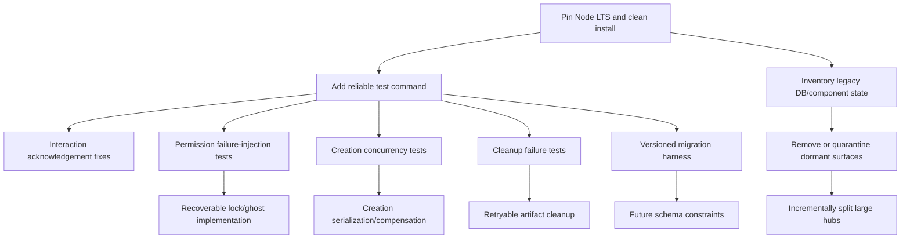

# Technical Debt Register

This register translates `code-quality-audit.md` into a dependency-aware backlog. It does not authorize changes to protected database, deployment, secrets, or permission-overwrite areas.

## Remediation checkpoint — 2026-11-18

The complete classification and evidence log now lives in `remediation-tracker.md`. The runtime, test-command, interaction-acknowledgement, supported dependency, and TypeScript resolver/compiler work is complete locally. Join-to-Create is serialized per guild, but its crash-compensation half remains blocked because it would change protected deletion behavior. Permission rollback, retryable artifact cleanup, and versioned migrations also remain blocked pending explicit approval and production-shaped validation data.

The standard local gate is now `npm test`, followed by `npm run lint`. It currently discovers 50 tests. Production dependencies audit clean; the remaining full-audit findings are development-only and blocked on an unpublished `picomatch` fix compatible with TypeScript 6.

**In simple terms:** Routine development now has a dependable test command and safer interaction handling; the remaining serious work is isolated behind explicit safety approvals or upstream releases.

## Priority summary

| Priority | Item | Audit refs | Impact | Effort | Depends on |
|---|---|---|---|---|---|
| Resolved 2026-11-18 | Normalize Node/native dependency contract | CQ-001 | Prevents accepted runtimes from failing at DB open; restores trustworthy tests | Small-medium | None |
| Must fix | Establish one reliable test command/gate | CQ-006 | Makes regression coverage routine | Small | Runtime normalization |
| Must fix | Make active interactions acknowledge promptly | CQ-003 | Prevents duplicate/failed user interactions | Medium | Focused response-state tests |
| Must fix | Make lock/ghost partial failures recoverable | CQ-002 | Protects owner/admin access and DB truth | Medium-high | Failure-injection tests; human approval for protected overwrite behavior |
| Should improve | Serialize/idempotently compensate room creation | CQ-004 | Prevents duplicate/orphan rooms | Medium-high | Runtime/test gate; possible protected schema approval |
| Should improve | Preserve retryable cleanup state on child failure | CQ-005 | Prevents orphan legacy artifacts | Medium-high | Backup plan; protected deletion/DB approval |
| Should improve | Introduce versioned migrations | CQ-009 | Makes future schema evolution predictable | Medium | Backup/restore validation; protected DB approval |
| Should improve | Retire or quarantine inactive feature generations | CQ-007 | Reduces confusion and dependency surface | Medium | Legacy-data/component inventory |
| Should improve | Narrow/log broad fallback catches | CQ-010 | Improves production diagnosis | Small-medium | Logging conventions |
| Optional | Split large hubs incrementally | CQ-008 | Improves local reasoning and change isolation | Medium | Characterization tests; dormant-surface decision |
| Optional | Harden boundary typing and test doubles | CQ-012 | Makes upgrades safer | Small-medium | None |
| Optional | Contain/monitor synchronous log writes | CQ-013 | Improves resilience under disk failure/load | Small | None |
| Requires investigation | Remove privileged GuildMembers intent | CQ-011 | Least privilege and simpler bot verification | Small if safe | Live test bot |
| Optional | Correct dormant TTS partial upsert | CQ-014 | Removes latent reset behavior | Small | Only before TTS reactivation |
| Optional | Break panel/text type-level cycle | CQ-015 | Clarifies domain ownership | Small | Do alongside related extraction |

## Runtime and verification

### Resolved — Supported runtime contract

**Status:** Resolved in the repository on 2026-11-18. `engines.node` now requires Node `>=24 <25`, the alpha npm `node` dependency is gone, and a clean official Node 24.18.0 validation passed the native SQLite smoke test, lint, build, and all 44 compiled tests. The local machine and VPS still need to be switched to Node 24 through the approved operator workflow.

### Resolved — First-class tests

`npm test` now builds and runs `node --test dist/tests/*.test.js`. This bypasses the Windows `tsx`/`os.userInfo()` failure and currently discovers 50 tests. Lint remains a separate required gate.

### No change recommended

Keep strict TypeScript options, ESLint coverage over `src scripts tests`, the temporary-DB helper, and focused pure-logic tests. They are good foundations.

## Discord interaction layer

### Resolved locally — Acknowledgement discipline

Define one rule: any path that may await Discord, network, filesystem, or non-trivial service work must acknowledge immediately. Apply it first to active `/setup` and `/support`, then to still-reachable panel components. Keep `/voice`'s early deferral pattern.

Active `/setup`, `/support`, `/voice`, panel button/select, and panel modal paths now acknowledge before network or mutation work. Ephemeral responses use `MessageFlags.Ephemeral`, and avatar fetching has a 1.5-second abort timeout. Live latency validation remains part of the Discord release checklist.

### Should improve — Error classification

Log interaction-expiry code 10062 and unexpected fallback errors with command/custom ID, guild, and user IDs. Continue suppressing only the duplicate response that cannot be repaired. Preserve user-safe messages.

### Requires further investigation — Privileged intent

Test the complete active flow without `GuildMembers`. Do not remove it based on static analysis alone because member caching differs with guild size and interaction option shapes.

## Room lifecycle and permissions

### Implemented locally — Partial permission mutation

Design lock/ghost as recoverable multi-step operations before editing code. The validation matrix must inject failure after each Discord overwrite call and assert:

- owner retains required access;
- bot retains required access;
- administrator/management roles are not stranded;
- unrelated overwrites are unchanged;
- SQLite reflects the actual Discord state or a reconciliation-needed state;
- retry is idempotent.

The approved implementation now snapshots only the managed bit, applies owner/bot/ManageChannels safety allows before the broad deny, verifies fresh effective permissions, and performs compensating rollback. Failure injection covers every write before and after remote mutation plus rollback failure. A disposable-guild pass remains required.

### Implemented locally — Creation serialization and compensation

`KeyedSerialExecutor` serializes generator work per guild. Creation is now tracked before movement, destructive compensation requires the exact database row, persistence failures are bounded-retry and never delete an untracked room, and migration 4 enforces unique `(guild_id, owner_user_id)` after a duplicate preflight. Live rapid reconnect remains a release check.

### Implemented locally — Cleanup retryability

Cleanup now returns explicit completed or retry-required results. A linked-child failure retains the parent row, mapping, and persisted TTS settings, stops active playback, and retries idempotently through startup or channel-delete recovery.

### No change recommended

Retain DB-confirmed destructive operations, targeted overwrite edits, cooldowns, startup recovery, and manual-channel-delete recovery. These are the strongest safety properties in the repository.

## Database and persistence

### Implemented locally — Versioned migrations

Numbered migrations now use a ledger and per-migration transactions. The runner accepts an explicit connection, refuses unknown schemas, preserves rows, checks integrity and foreign keys, and verifies backup restoration. It must still be rehearsed on a restored production-shaped copy before deployment.

### Optional — Repository result checks

Update methods currently perform a write then re-read, which detects missing rows. Where useful, also inspect `changes` to distinguish “target absent” from a post-write read problem. Keep repositories synchronous and simple; an ORM would not add value here.

### Optional — Dormant TTS update semantics

Before any TTS reactivation, separate “insert defaults” from “update one setting” so omitted optional values do not reset existing state.

## Code organization

### Should improve — Active versus compatibility surface

Create an explicit disposition list:

- active: five registered commands, room lifecycle, recovery, required repositories;
- compatibility-only: stale command/component responses and cleanup of historical linked rows;
- dormant candidate: TTS code intended for later recovery;
- removable: duplicate standalone adapters with no registration or compatibility role.

Remove code only after checking stored interface/text/TTS rows and stale Discord messages. If dormant TTS stays, move it behind a clearly named boundary and avoid importing its large runtime into the active bootstrap solely for cleanup helpers.

### Optional — Cohesive extraction

Prefer small extractions driven by a specific change:

- `/voice` subcommand handlers and response formatting;
- access moderation versus channel presentation controls;
- target resolution/authorization versus panel rendering;
- TTS config/queue/subprocess/voice-connection boundaries.

Do not introduce generic factories, managers, command buses, or DI containers. They would replace visible conditional complexity with framework complexity that this bot does not need.

### Optional — Shared domain contracts

Move `ResolvedPanelTarget` only when touching panel/text coupling. A neutral `types` or room-domain module would eliminate the type-level cycle without a broad refactor.

## Logging and operations

### Should improve — Actionable fallback logs

Expected Discord conditions should be classified by code; unexpected conditions should retain original error/stack. Add operational signals for interaction expiry, partial permission mutation, cleanup retry needed, and orphan-compensation attempts.

### Optional — File logging resilience

At current scale, a synchronous logger is acceptable if disk health/rotation are operationally managed. At minimum, avoid letting a secondary file-write failure conceal the original application error. A full logging framework is optional, not required.

## Dependency order

## Modernization recommendation

Modernize incrementally. The active architecture is suitable for continued development after the high-priority reliability work. Preserve the service/repository layering and safety checks. Do not rewrite the whole bot. Keep TTS disabled; if product demand returns, reassess its 861-line playback runtime as an isolated subsystem after the core runtime and test toolchain are stable.
